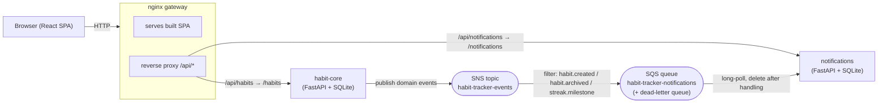

# Habit Tracker

A habit-tracking app, built as a learning project and structured as microservices
behind an nginx gateway. Backends are Python/FastAPI; the frontend is a React +
Vite SPA. The docker-compose stack runs **PostgreSQL** (one database per service)
and **LocalStack** (emulated AWS SNS + SQS); SQLite remains the default for tests and no-Docker local runs.

## Architecture



**Two communication axes:**

- **Synchronous (HTTP)** — the browser and any request/response that needs an
  immediate answer. All client traffic is same-origin `/api/*` through nginx,
  so there's no CORS.
- **Asynchronous (events over SNS + SQS)** — cross-service reactions. habit-core
  *publishes facts* (`habit.logged`, `streak.milestone`, …) to an SNS topic and
  never calls other services directly. Each consumer owns an SQS queue subscribed
  to the topic with a filter on the `event_type` attribute; notifications polls
  its queue and reacts. This keeps the services decoupled: notifications can be
  down and events simply buffer in its queue. A message is deleted only after its
  handler succeeds; repeated failures land in a dead-letter queue.

The transport is hidden behind an `EventBus` interface (`libs/events`), so it's a
swappable detail — `InMemoryEventBus` for tests/local, `SnsEventBus` (SNS publish,
SQS consume) in compose (LocalStack) and on AWS — without touching business logic.
The exact AWS resources, subscription settings, IAM and env vars the app expects
are specified in [`docs/messaging.md`](docs/messaging.md); the database variables
(`DATABASE_URL`, or `DB_HOST`/`DB_NAME`/`DB_USER`/`DB_PASSWORD`/`DB_SSLMODE`) and
the notifications database bootstrap job in [`docs/database.md`](docs/database.md).

## Layout

```
libs/events/            Shared domain-event contracts + EventBus (InMemory + SNS/SQS)
services/
  habit-core/           Habits, logs, streaks, stats. Publishes domain events.
  notifications/        Consumes events; owns its store + REST API. Keeps a local
                        read-model of habits (event-carried state) so it can render
                        habit names without calling habit-core.
frontend/               React + Vite + Tailwind SPA (see frontend/README.md)
deploy/                 nginx.conf, docker-compose.yml, localstack/ (SNS/SQS init script)
docs/messaging.md       The app <-> AWS messaging contract (resource names, IAM, env vars)
docs/database.md        The app <-> PostgreSQL/RDS contract (DB_* env vars, secrets, TLS, bootstrap job)
tests/integration/      Cross-service event-contract test (in-process, no broker)
```

## Domain events

| Event (`event_type`) | Published by (SNS) | Consumed by (SQS) | Effect |
|---|---|---|---|
| `habit.created` | habit-core | notifications | Build read-model entry + "now tracking" notification |
| `habit.archived` | habit-core | notifications | Mark read-model entry archived |
| `habit.logged` | habit-core | *(none yet — no subscription matches)* | Carries `goal_met`; reserved for future reminder logic |
| `streak.milestone` | habit-core | notifications | Congratulatory notification at 7/14/30/… day streaks |

Contracts live in [`libs/events`](libs/events/src/habit_events/events.py) — both
producer and consumer import them, so the wire format is a single reviewable source.

## Running

### Full stack (docker-compose)

```bash
docker compose -f deploy/docker-compose.yml up --build
# open http://localhost:8080
# LocalStack (SNS/SQS) listens on http://localhost:4566; the topic, queues and
# subscription are created by deploy/localstack/init-aws.sh on startup.
```

### Locally without Docker

Each service is an independent Python package. Install into one virtualenv for
development:

```bash
python -m venv .venv && . .venv/Scripts/activate    # (.venv/bin/activate on *nix)
pip install -e "libs/events[aws,dev]" \
            -e "services/habit-core[dev]" \
            -e "services/notifications[dev]"

# habit-core (defaults to the in-memory bus — no broker needed):
uvicorn habit_core.main:app --port 8000 --app-dir services/habit-core/src

# frontend (proxies /api → http://127.0.0.1:8000):
cd frontend && npm install && npm run dev
```

To use the AWS transport outside Docker, start the LocalStack service from the
compose file and set, per service, `EVENT_BUS=aws`, `AWS_REGION=us-east-1`,
`AWS_ENDPOINT_URL=http://localhost:4566`, dummy `AWS_ACCESS_KEY_ID`/
`AWS_SECRET_ACCESS_KEY` (`test`), and `SNS_TOPIC_ARN` (habit-core) or
`SQS_QUEUE_URL` (notifications) — values are in `deploy/docker-compose.yml`
(use `localhost` instead of `localstack`). All variables are listed in
[`docs/messaging.md`](docs/messaging.md).

## Testing

```bash
# per package (mirrors per-service CI)
(cd libs/events && pytest)        # SNS/SQS adapter tests run against moto
(cd services/habit-core && pytest)
(cd services/notifications && pytest)
# cross-service event contract (in-process InMemory bus, no broker)
pytest tests/integration
```

## Status / roadmap

- **Now:** habit-core + notifications + gateway; SNS/SQS events (LocalStack in
  compose); PostgreSQL (one DB per service) in compose. Delivery is at-least-once,
  so a redelivered event can produce a duplicate notification (events carry no id
  yet).
- **Design-forward UI not yet in the model:** weekly/`x-per-week` frequency
  ("Day 3/5"), time-of-day, reminders. The `frequency_type`/`frequency_config`
  columns and the `is_scheduled()` abstraction are in place for when these land.
- **Next:** wire the frontend to the live API (it still uses mock data); add a
  time-based reminder scheduler in the notifications service (consuming
  `habit.logged` to suppress reminders once a habit is done for the day); AWS
  deployment (services on ECS, real SNS/SQS per `docs/messaging.md`, RDS).
```
